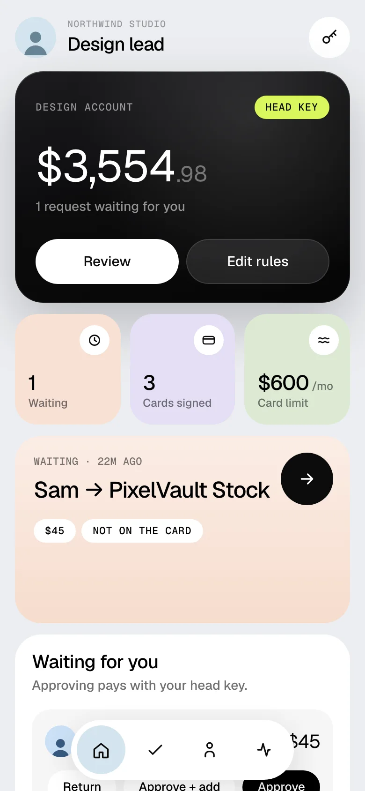
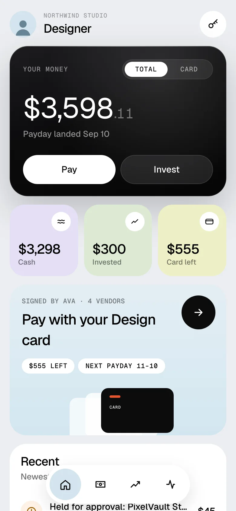
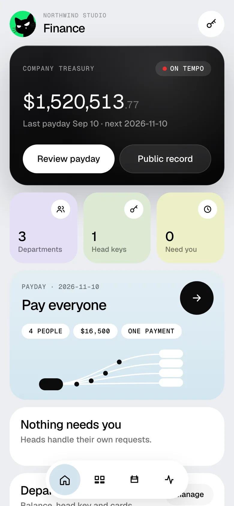

<p align="center">
  <picture>
    <source media="(prefers-color-scheme: dark)" srcset="brand/logo-v4/final/teampot-symbol-reversed.svg" />
    
  </picture>
</p>

<h1 align="center">Teampot</h1>

<p align="center"><b>Work money that's actually yours.</b><br />
Your pay, your team's budget and your perks in one app, on <a href="https://tempo.xyz">Tempo</a>. Spend it, hold it or invest it, while every team runs its own money.</p>

<p align="center">
  <a href="https://teampot.vercel.app"><b>Website</b></a> ·
  <a href="https://teampot.vercel.app/app"><b>Live demo</b></a> ·
  <a href="https://teampot.vercel.app/tour"><b>Guided tour</b></a> ·
  <a href="ARCHITECTURE.md">Architecture</a> ·
  <a href="app/VERIFIED.md">Verified on Tempo</a>
</p>

<p align="center">
  
  
  
</p>

> Runs on the Tempo **Moderato testnet** with test money. In the demo you can switch between Finance (Jordan), a department head (Ava), an employee (Sam) and a contractor (Mateo).

## Why

In most companies, Finance approves every small purchase, and the people closest to the work have no budget they control. The fix everyone wants is "give each team its own money with guardrails". Card programs express that badly, and the guardrails live in software that can be bypassed or go down.

Teampot puts the guardrails on Tempo itself. Finance sets the frame, teams decide, and Tempo enforces it.

## How it works: every level gets its own key

```
Company treasury        Finance: funds departments, runs payday
  └ Department account  one per team; its balance is the budget
      └ Head key        admin key from Finance (TIP-1049)
          └ Cards       signed by the head: limit + vendor list
```

- **Pay from your phone.** Sam pays Figma with his Design card. Tempo checks the monthly limit and the vendor list.
- **Off the card? Tempo refuses it.** The payment becomes a request to Ava. She approves with her head key, and "Approve + add" puts the vendor on everyone's card.
- **Payday in about a second.** One payment from the treasury pays everyone, each line with its own note.
- **Your pay stays in the app.** Hold it in dollars, spend it, or invest part of every payday in test stock tokens on Tempo's stablecoin exchange.
- **Contractors** send an invoice and are paid in seconds.
- **Every action links to its public record** on the Tempo explorer.
- **Agent cards.** A head gives an AI agent its own card; it pays with its agent key, inside limits Tempo enforces.
- **Send money** to a teammate's @username or a saved payee, from your own pay.
- **Visa card (issuer-ready).** Tap at a shop: the swipe is checked against the same Tempo card and settled on Tempo. Simulated until Stripe Issuing is plugged in ([ISSUING.md](ISSUING.md)).
- **Idle budgets earn.** Simulated on testnet; real Tempo Earn once a vault is configured.

The full permission model (who can do what, and whether Tempo or Teampot enforces it) is in [ARCHITECTURE.md](ARCHITECTURE.md).

## What's real on Tempo

Proven on Moderato and covered by the end-to-end suite ([app/VERIFIED.md](app/VERIFIED.md)):

- Department accounts funded from the treasury; budget changes move real money.
- Head admin keys (TIP-1049) that sign member cards. Probe: over-limit, off-list and revoked payments are all rejected by Tempo.
- Cards as access keys with periodic limits and recipient scopes; perks as separate cards.
- Face ID passkeys as card keys (WebAuthn), with server-side receipt verification.
- Payday as one batch payment with a memo per line.
- Approvals and contractor invoices paid from the department account with the head key.
- Test stock tokens (TIP-20) and buys and sells on Tempo's stablecoin exchange.

**Honest limits.** Department roots and the demo people's keys are held by the server (invited people use Face ID on their own phone). The "over $1,000 needs Finance" rule is checked by Teampot, because Tempo limits are per period. Earning is labelled Simulated until Tempo has a testnet vault. Stocks are test tokens priced from delayed market data.

## Where it's going

Stripe offers companies stablecoin treasury, cards and payouts, and Tempo is Stripe's default chain. Teampot is the app the people inside the company use. The production path: every Teampot account is a wallet plus a card, and the card is also a Visa card through Stripe Issuing, backed by the department's Tempo balance, with one rule set on both rails. Details and the roadmap: [STRIPE_FIT.md](STRIPE_FIT.md).

## Built with

Tempo (`viem/tempo`, `ox`), TypeScript, Hono on Vercel, React 19 + Vite (installable web app), Upstash Redis, WebAuthn passkeys, Playwright and Vitest. Built with Claude Code and OpenAI Codex.

## Run it

```bash
cd app
cp .env.example .env        # set OPERATOR_PK to a funded Moderato testnet key
npm install && (cd web && npm install)
npm run build
PORT=8790 npx tsx server/local.ts
```

Open `http://localhost:8790` for the website, `/app` for the app and `/tour` for the guided tour. More detail, tests and environment variables: [app/README.md](app/README.md).

## Repo map

| Path | What |
|---|---|
| [app/](app/) | Server (`server/`), web app and website (`web/`), test scripts (`scripts/`) |
| [ARCHITECTURE.md](ARCHITECTURE.md) | Delegation model, permission matrix, honest limits |
| [app/VERIFIED.md](app/VERIFIED.md) | Every claim with testnet evidence |
| [STRIPE_FIT.md](STRIPE_FIT.md) | Teampot and the Stripe stablecoin stack |
| [ISSUING.md](ISSUING.md) | Plugging in Stripe Issuing, Tempo Earn and mainnet |
| [brand/](brand/) | Logo, design spec, Tempo case study |
| [submission/](submission/) | Hackathon submission and scripts |

MIT licensed.
